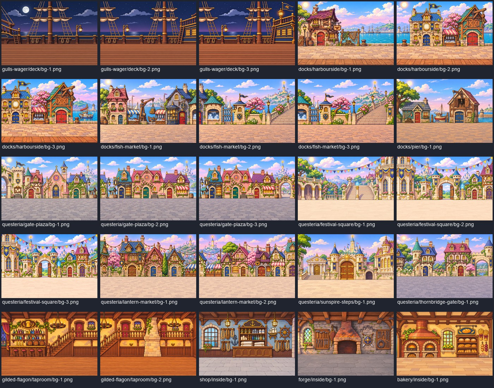

# Room background artwork

Original source illustrations created with ChatGPT's built-in image generation for Caleb Kiatoukaysi, following `Story/14-background-prompts.md` and the supplied room-background PDF. Broad visual inspiration: [AQW Battleon Town](https://aqwwiki.wikidot.com/battleon-town); no AQW game images are included in this collection.

## Progress

| Asset type | Saved | Brief total |
| --- | ---: | ---: |
| Background panels, including interiors | 50 | 74 |
| Transparent foreground strips | 0 | 22 |
| Floor textures and overlays | 0 | 90 |
| Total | 50 | 186 |

Generation stopped at the account image-generation usage limit. The tool reported the next reset as November 19, 2026 at approximately 12:06 AM America/Chicago. The remaining 136 assets are explicitly marked pending in the manifest; no existing game art is counted toward these totals.

## More detailed art direction

The owner requested more background detail during production. The revised Lantern Market first panel demonstrates the direction: carved timber joints and corbels, roof construction and wear, richer stonework, window tracery, metal fittings, individual leaf and blossom clusters, lantern construction, and a layered distant city. Later panels use the richer direction where recorded in `completed-assets.json`. Earlier panels still need the same detail revision; this collection does not claim that every panel has received it.

Keep the clean outlined, cel-shaded style and a quiet open walking band. Architectural and environmental detail belongs above that band. Preserve each room's palette, lighting, door layout and story setting.

## Files and review status

- `generated/<zone>/<room>/bg-<panel>.png`: full-resolution 1536 x 1024 source paintings.
- `previews/contact-1.jpg` and `previews/contact-2.jpg`: labeled review sheets.
- `generation-manifest.json`: all 186 planned assets, their full baseline prompts, revised detail direction, intended import destinations, and generated/pending status.
- `completed-assets.json`: the 50 saved sources, generation method, revision metadata and prompts.

These are source-art candidates, not imported runtime textures. Visual review found deviations in threshold heights, door sizes/positions, and panel overlaps. In particular, several paintings put the back edge of the floor below the prescribed y=656 line. Door geometry and joins must be fitted to the layout templates before runtime import. The images remain separate from `Content/Rooms` so the current game is unchanged.

After fitting and completing a room, copy its panels to the manifest's `importDestination` paths under `tools/source/rooms`, then run the existing `cut_room.py` and asset checks. Do not copy an incomplete room into that import directory. Foregrounds and tiles remain ungenerated.

