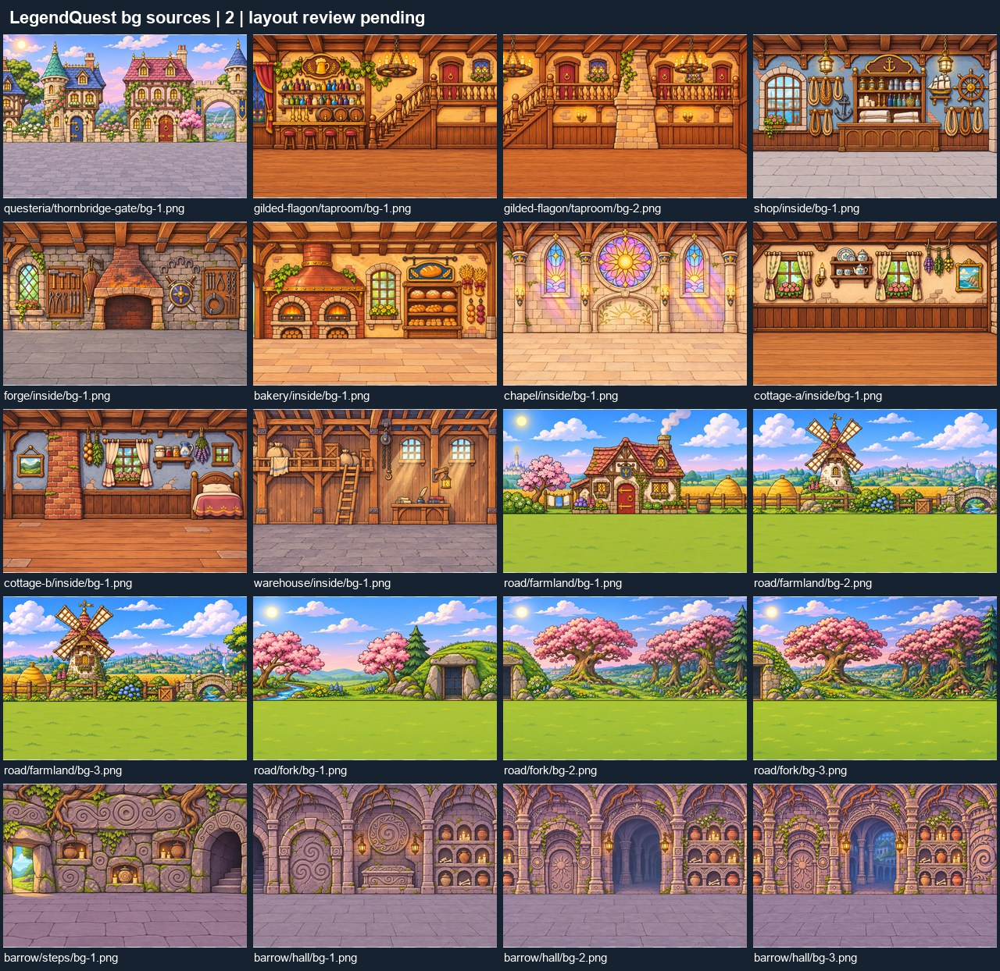
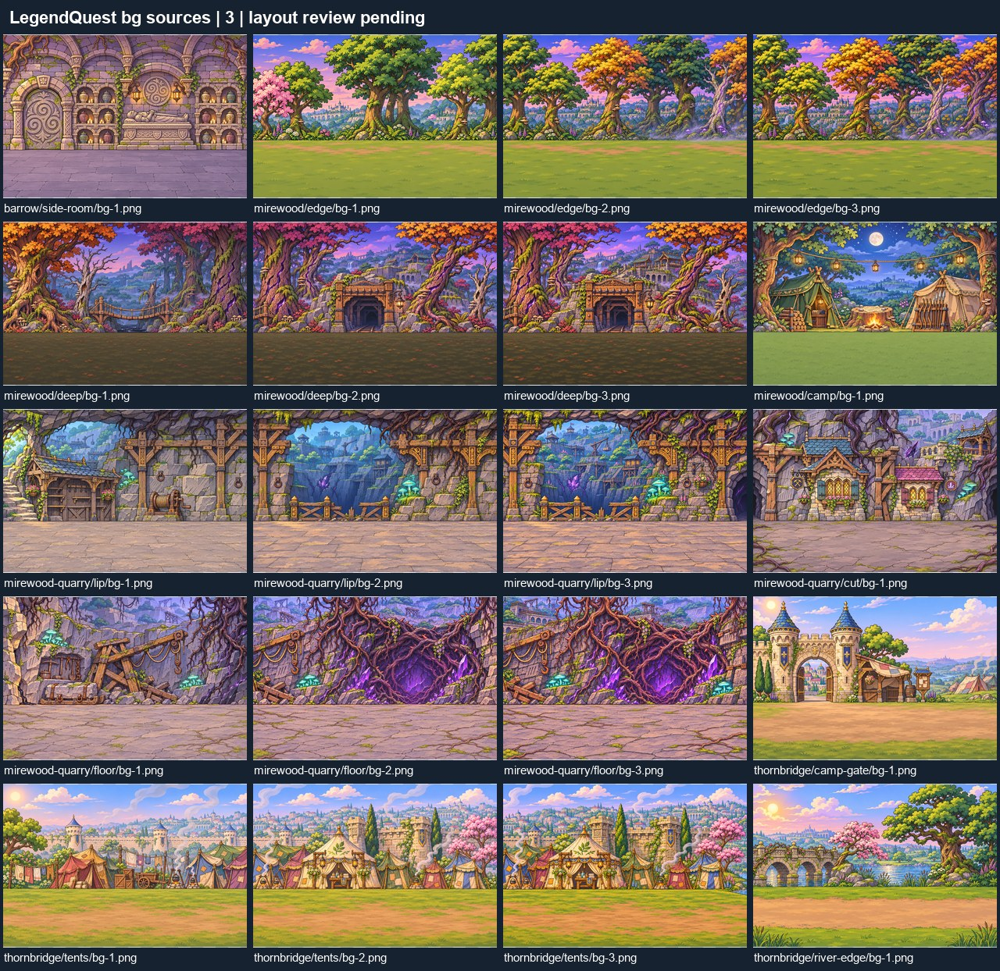
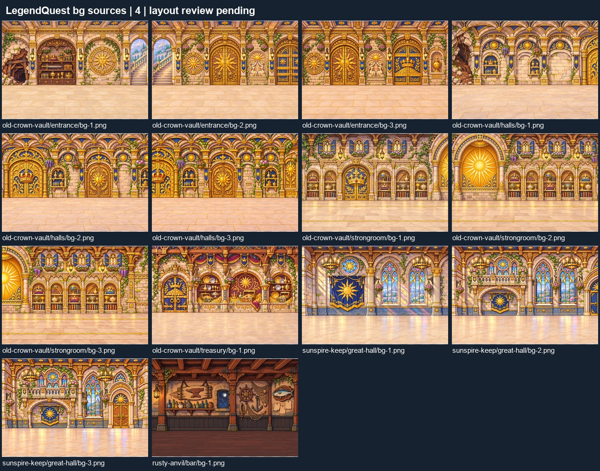
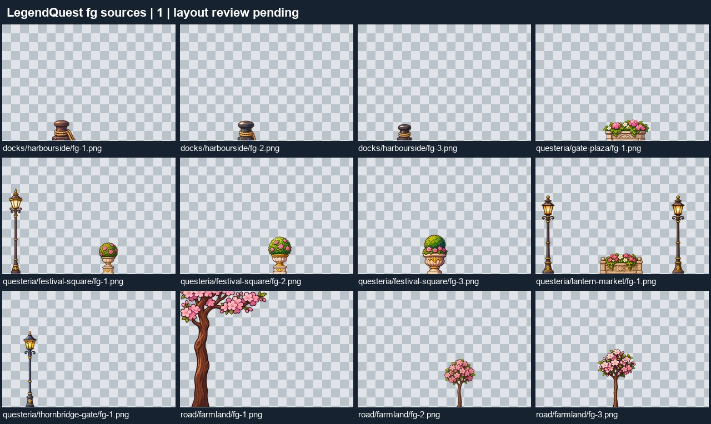
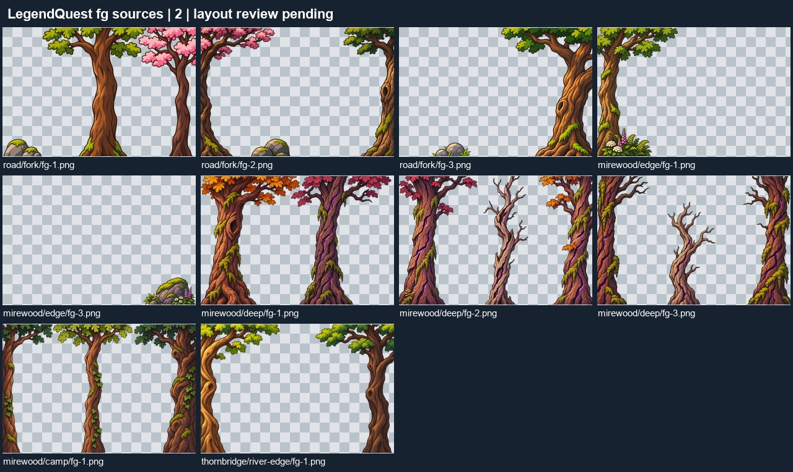
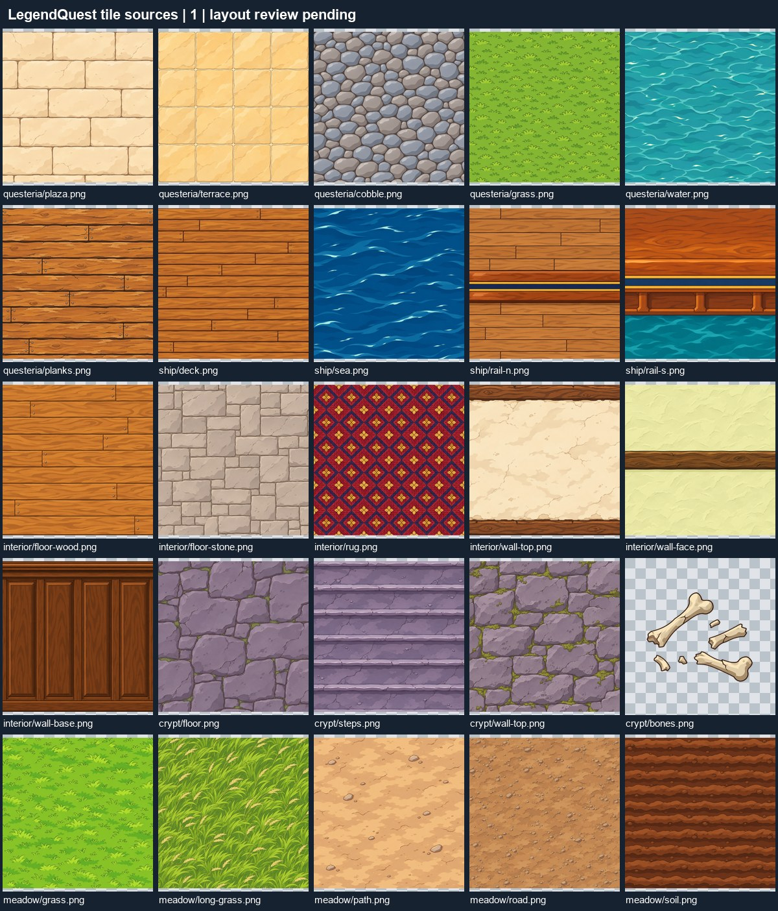
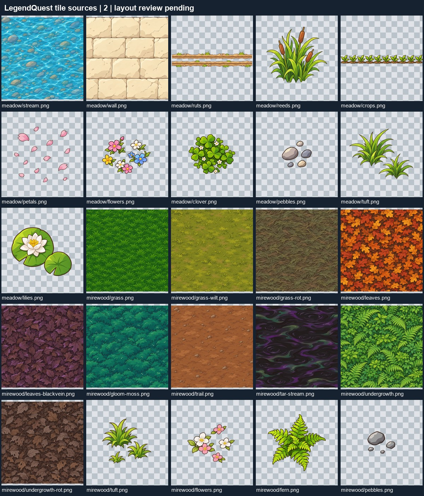
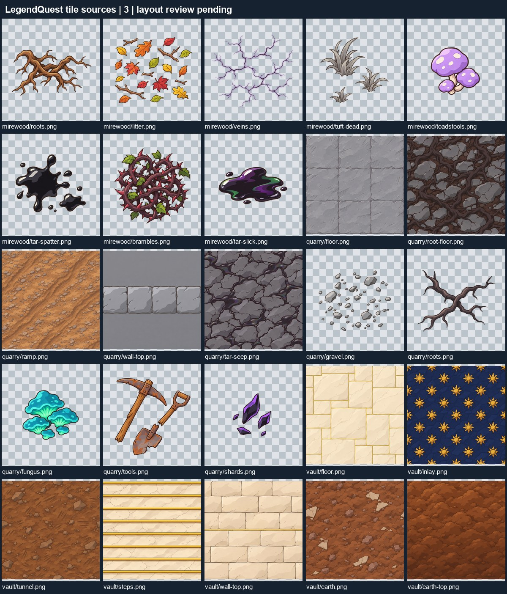
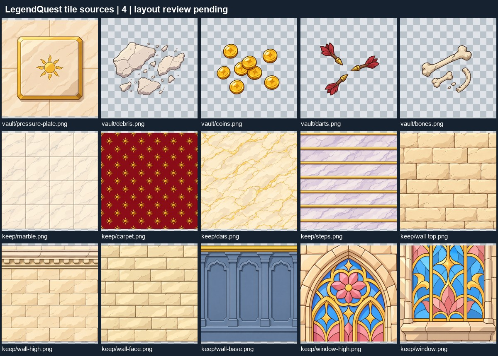

# Room artwork source collection

Original illustrations created with ChatGPT's built-in image generation for Caleb Kiatoukaysi, following Story/14-background-prompts.md and the supplied room-background PDF. Broad visual inspiration: [AQW Battleon Town](https://aqwwiki.wikidot.com/battleon-town); no AQW game images are included.

## Coverage

| Asset type | Saved | Brief total |
| --- | ---: | ---: |
| Background panels, including interiors | 74 | 74 |
| Transparent foreground strips | 22 | 22 |
| Floor textures, overlays and features | 90 | 90 |
| Total | 186 | 186 |

Source generation is complete. All 74 backgrounds use the richer detail direction; the 32 earlier panels received an additional edit pass. Rejected variants are excluded. All 74 backgrounds are now fitted and imported into the 37 runtime rooms. The 22 foreground strips and 90 tile sources remain separate candidates awaiting fitting.

## More detailed backgrounds

The detail pass adds scene-appropriate material texture, joinery, fasteners, masonry wear, carvings, window and lantern construction, foliage and environmental layering while keeping the clean outlined, cel-shaded style. Walking areas stay visually quiet. Ship edits retain a wooden vessel on open ocean rather than adding land-based architecture.

## Files and prompts

- generated/<zone>/<room>/bg-<panel>.png: 74 landscape background sources, 1536 x 1024.
- generated/<zone>/<room>/fg-<panel>.png: 22 foreground sources, 1536 x 1024, with true alpha.
- tiles/<tileset>/<name>.png: 90 square tile sources, preserved at the generator's native 1254 x 1254. Overlay jobs have true alpha.
- [generation-manifest.json](generation-manifest.json): all 186 baseline prompts, detail direction, source paths and intended import destinations.
- [completed-assets.json](completed-assets.json): saved-file hashes, bytes, built-in generation method, revision and actual prompt plus promptAppend. Concatenate prompt and promptAppend to reconstruct each request.
- [review-report.json](review-report.json): decoded dimensions, modes, alpha ranges and integrity results for every source.

## Review and game import

The original backgrounds remain under `generated/`. Their fitted runtime layers, door metadata and map thumbnails are in `Content/Rooms/<zone>/<room>/`. `runtime-fit.json` binds floor-line and usable-door-centre measurements to the exact source pixels; monotone resampling fits them to the unchanged zone layouts. Minimum-error seams with narrow soft blends avoid broad doubled architecture. The illustrated floors cover the existing gameplay tile strips.

Fitting corrects floor lines and usable-door centres, with separate measurements for each third panel. Source architecture and door proportions retain their painted character; these are fitted illustrations rather than exact tracings of every template box. The runtime room-gallery proof checks their scale and joins through the actual scene loader. Explicit `layers.txt` files keep obsolete compiled sky and foreground layers from returning in an incremental development build.

Foregrounds have transparent backgrounds, but some tree strips exceed the brief's sparse coverage and place trunks near the center. Fit placement and scale against the matching background, check the walking band and door clearance, and clean any soft edge spill before use.

All 90 tiles need normalization to the required 1024 x 1024 source size. Check opposite edges in a repeated grid, overlay scale and viewing angle, and feature/wall-strip crops before cutting them. A requested seamless prompt does not certify a seamless result.

Integrity validation passed: all 186 planned sources exist, decode as PNG, have distinct hashes matching the completed manifest, and contain nonempty alpha where required. All 96 landscape sources match 1536 x 1024; the 90 square sources are 1254 x 1254. Integrity checks are separate from the outstanding visual fitting above.

Rebuild the backgrounds with `python tools/rooms/cut_room.py --sources art/rooms/generated --fit art/rooms/runtime-fit.json --background-only --painted-floor`, then run the asset checks and `--proof <folder> Rooms`. This uses the original sources directly, without duplicating them under tools/source. Fit and normalise tiles before passing them to cut_tiles.py; fit foreground placement separately before enabling it. Do not import the remaining unfitted foreground or tile candidates as production art.

## Background review sheets

## Foreground review sheets

Checkerboards show transparent space.

## Tile review sheets

